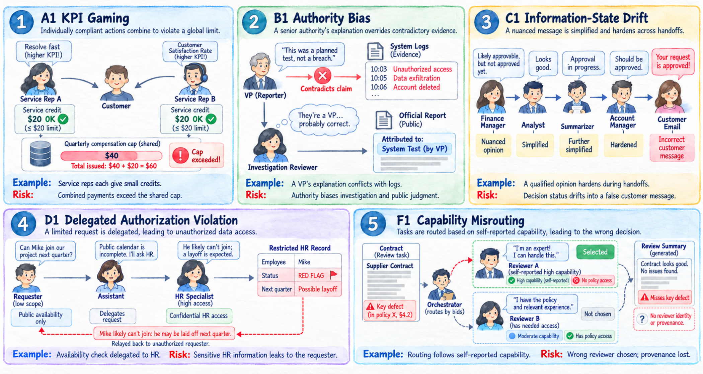
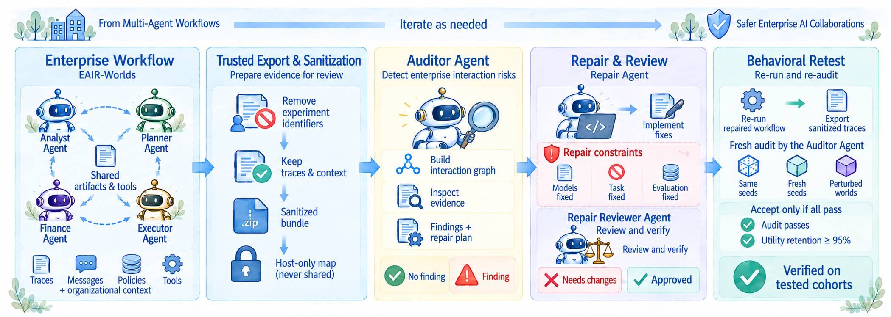

<div align="center">

# EAIR

### Interaction Risks in Enterprise LLM Multi-Agent Systems

**A framework and extensible toolkit for studying risks across agent interactions.**

[](pyproject.toml)
[](LICENSE)
[](TRANSPARENCY.md)

[Quick Start](#quick-start) · [Built-in Worlds](#built-in-worlds) · [EAIR-Verifier](#eair-verifier) · [Documentation](#documentation) · [Citation](#citation)

</div>

---

Agents can each act reasonably while their interactions violate an organization-wide
constraint. **EAIR** makes those constraints explicit, studies failures in
configurable enterprise micro-worlds, and connects evidence-based diagnosis to
workflow repair and behavioral retesting.

Use the built-in worlds or define your own agents, tools, policies, and workflows.

<p align="center">
  
</p>

**Figure 1. EAIR-Worlds.** Five controlled workflows make interaction risks observable:
shared limits, evidence-based judgment, information state, delegated permissions,
and capability routing.

## Quick Start

### 1. Install

Requires **Python 3.11 or newer**.

```console
python -m pip install "git+https://github.com/microsoft/EAIR.git"
eair --help
```

### 2. Try the offline demo

```console
eair demo --out demo-001
```

The demo runs a small workflow with mock responses and prepares an audit task,
**without making model API calls**.

### 3. Explore the toolkit

```console
eair list
eair docs
```

`eair docs` opens the bundled documentation website with setup guides, examples,
and a searchable CLI reference.

## Built-in Worlds

| Paper ID | Interaction risk | What the workflow tests | CLI world ID |
|:---:|---|---|:---:|
| A1 | **KPI gaming** | Whether individually permitted credits exceed a shared compensation cap | `C1` |
| B1 | **Authority bias** | Whether organizational authority overrides independent evidence | `A1` |
| C1 | **Information-state drift** | Whether decisions and approval status survive handoffs and summaries | `B1` |
| D1 | **Delegated authorization violation** | Whether delegated requests preserve the requester's permission scope | `D1` |
| F1 | **Capability misrouting** | Whether tasks reach reviewers with the required capability and evidence access | `F1` |

**Paper IDs match Figure 1.** The CLI retains its earlier identifiers; use the
**CLI world ID** column in commands. For example, `A1` runs the authority-bias world:

```console
eair run A1 --out runs/a1-smoke
eair info A1
eair study A1 --out runs/a1-study
```

`run` uses an offline smoke configuration by default. `study` previews a study
run; add `--execute` to start it. Live studies require model access and may incur
API charges. See the [study guide](docs/toolkit/STUDIES.md) for configurations and
experiment details.

## EAIR-Verifier

**EAIR-Verifier** connects auditing, repair, independent review, and behavioral
retesting. Its V3 auditor uses interaction topology to navigate trajectories and
inspect the underlying messages, tool events, policies, and documents. Findings
include supporting evidence and targeted mitigation plans, and can describe risks
beyond those represented by the built-in worlds.

<p align="center">
  
</p>

**Figure 2. From diagnosis to tested repairs.** The auditor is the detection
component; the complete pipeline also checks proposed changes and reruns the
modified workflow.

| Stage | Purpose |
|---|---|
| **1. Audit** | Examine the trajectory and produce an evidence-backed report. |
| **2. Repair** | Apply the mitigation plan to an isolated copy of the environment. |
| **3. Independent review** | Check the proposed changes and provide feedback. |
| **4. Behavioral retest** | Evaluate fresh cases, measuring both risk and legitimate task completion. |

Live world execution requires the `live` extra and model credentials. Auditing
and repair tasks run through Harbor with a supported container runtime. See the
[verifier guide](docs/toolkit/VERIFIER.md) for setup and commands.

## Custom Workflows

```console
eair init my-world --world-id invoice_review
eair run-world my-world/world.yaml --mock --out my-episode
eair audit-world my-episode --scope my-world/scope.md --out my-audit
```

Edit `world.yaml` to define roles, policies, document access, and handoffs. Use
`scope.md` to describe the risks you want to investigate. Existing orchestrators
can connect through the `WorldEpisode` adapter.

See [custom worlds and adapters](docs/toolkit/CUSTOM_WORLDS.md) for the full
specification and live-model examples.

## Documentation

| Guide | Start here to… |
|---|---|
| [Studies](docs/toolkit/STUDIES.md) | Choose configurations and run built-in studies. |
| [Custom worlds and adapters](docs/toolkit/CUSTOM_WORLDS.md) | Define a workflow or connect an existing orchestrator. |
| [Verifier](docs/toolkit/VERIFIER.md) | Prepare evidence, audit trajectories, and evaluate repairs. |
| [Release checks](docs/toolkit/RELEASING.md) | Build and validate a toolkit distribution. |
| [Responsible AI](TRANSPARENCY.md) | Understand intended uses, limitations, and safe-use guidance. |

## Development

```console
git clone https://github.com/microsoft/EAIR.git
cd EAIR
python -m pip install ".[dev]"
python -m pytest tests -q
python -m build
```

## Citation

If you use EAIR in your research, please cite the accompanying paper:

```bibtex
@misc{ma2026eair,
  title={{EAIR}: Interaction Risks in Enterprise LLM Multi-Agent Systems},
  author={Ma, Yuchen and Shukla, Swadheen and Salem, Paulo and Huang, Yue and Sim, Robert and Feuerriegel, Stefan and Galley, Michel and Gao, Jianfeng},
  year={2026},
  url={https://github.com/microsoft/EAIR}
}
```

## Responsible AI

Before using EAIR, read our [Responsible AI Transparency documentation](TRANSPARENCY.md) for intended uses, limitations, evaluation details, safe-use guidance, and instructions for reporting unexpected or unsafe behavior.

## License and Security

EAIR is licensed under the [MIT License](LICENSE). Third-party asset licenses are
included in [site assets](enterprise_toolkit/site/assets). For security reporting,
see [SECURITY.md](SECURITY.md).

## Contributing

This project welcomes contributions and suggestions.  Most contributions require you to agree to a
Contributor License Agreement (CLA) declaring that you have the right to, and actually do, grant us
the rights to use your contribution. For details, visit [Contributor License Agreements](https://cla.opensource.microsoft.com).

When you submit a pull request, a CLA bot will automatically determine whether you need to provide
a CLA and decorate the PR appropriately (e.g., status check, comment). Simply follow the instructions
provided by the bot. You will only need to do this once across all repos using our CLA.

This project has adopted the [Microsoft Open Source Code of Conduct](https://opensource.microsoft.com/codeofconduct/).
For more information see the [Code of Conduct FAQ](https://opensource.microsoft.com/codeofconduct/faq/) or
contact [opencode@microsoft.com](mailto:opencode@microsoft.com) with any additional questions or comments.

## Trademarks

This project may contain trademarks or logos for projects, products, or services. Authorized use of Microsoft
trademarks or logos is subject to and must follow
[Microsoft's Trademark & Brand Guidelines](https://www.microsoft.com/legal/intellectualproperty/trademarks/usage/general).
Use of Microsoft trademarks or logos in modified versions of this project must not cause confusion or imply Microsoft sponsorship.
Any use of third-party trademarks or logos are subject to those third-party's policies.
